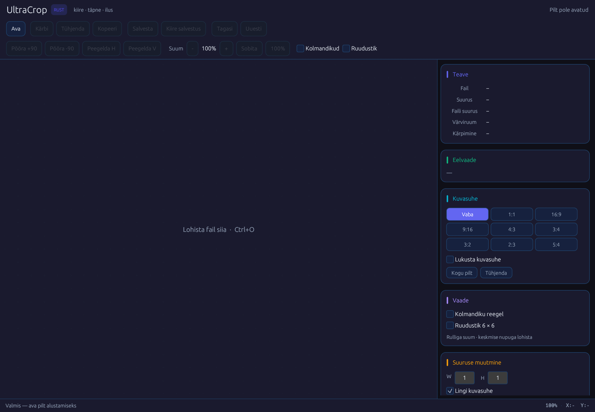

# UltraCrop 2.0

Kiire ja ilus pildilõikaja, kirjutatud uuesti Rustis (**egui/eframe**) — algne
programm oli Python + Tk. Kogu kasutajaliides, lõikeraam, käepidemed,
kolmandikevõrk ja eelvaade on joonistatud egui enda poolt, seega UI püsib
terav igal DPI-l ja näeb igal pool ühesugune välja.



## Funktsioonid

- **Lõikamine hiirega** — tõmba raam, liiguta seda või muuda suurust
  kaheksast käepidemest; raam püsib pildi piires.
- **Kuvasuhted** — Vaba, 1:1, 16:9, 9:16, 4:3, 3:4, 3:2, 2:3, 5:4.
  `Shift` joonistamisel/resize'imisel sunnib suhte 1.0.
- **Kuvasuhte lukustamine** — lukusta praegune (või pildi) suhe edasisteks
  lõigeteks.
- **Ülekatteid** — kolmandikevõrk ja ruudustik, lülitatavad tööriistaribalt.
- **Pildioperatsioonid** — pööra ±90°, peegelda horisontaalselt/vertikaalselt,
  muuda suurust (W/H, säilitades proportsiooni).
- **Undo/redo** — kuni 10 sammu, nii pildioperatsioonidele kui lõikamisele.
- **Eelvaade** — lõike reaalne tulemus ja mõõt pikslites külgpaneelil.
- **Salvestamine** — „Salvesta nimega" (PNG, JPEG, BMP, TIFF, WebP) ja
  „Kiire salvestus" (`<nimi>_karp.<ext>` lähtefaili kõrvale, vajadusel
  `_karp2`, `_karp3` …).
- **Lõikelaud** — `Ctrl+C` kopeerib lõike pildina (arboard, ilma
  xclip/xsel alampritsessideta).
- **Viimased failid** — kuni 8 viimati avatud faili, salvestatud
  `~/.config/ultracrop/recent.txt`.
- **PhotoCraft integratsioon** — „Ava PhotoCraftis" kirjutab lõike ajutise
  PNG-na ja avab selle PhotoCrafti jooksvasse aknasse.
- **Faili lohistamine** aknale, automaatne akna sobitamine pildi ja ekraani
  järgi, täisekraan suurte piltide puhul (`F11` läbib režiime).

## Paigaldamine ja käivitamine

Nõuded: Rust toolchain (2021 edition) ja Linuxil X11/Waylandi arenduspaketid,
mida eframe/winit vajavad.

```bash
cd app
cargo run --release
```

Release-binarii:

```bash
cd app
cargo build --release
./target/release/ultracrop
```

### Käsurea võimalused

```bash
ultracrop pilt.jpg                 # ava pilt kohe
ultracrop --screenshot shot.png    # joonista aken ja salvesta ekraanipilt
```

`--screenshot` on mõeldud automatiseeritud kontrollideks: rakendus joonistab
120 kaadrit, salvestab PNG ja sulgeb akna. Tundmatud `--lipud`
ignoreeritakse.

## Kiirklahvid

| Klahvid | Tegevus |
|---|---|
| `Ctrl+O` | ava pilt |
| `Ctrl+S` / `Ctrl+Shift+S` | salvesta nimega / kiire salvestus |
| `Ctrl+Z` / `Ctrl+Y` (`Ctrl+Shift+Z`) | tagasi / uuesti |
| `Ctrl+X` | rakenda kärbe |
| `Ctrl+C` | kopeeri lõikelauale |
| `Ctrl++` / `Ctrl+-` | suum ×1.25 / ×0.8 |
| `Ctrl+0` | sobita aknasse |
| `R` / `Shift+R` | pööra 90° päripäeva / vastupäeva |
| `H` / `V` | peegelda horisontaalselt / vertikaalselt |
| Nooled / `Shift`+nooled | nihuta raami 1 px / 10 px |
| `Esc` | tühjenda raam |
| `F11` | täisekraan |

Hiir: ratas suumib kursoril, keskmine või parem nupp lohistab pilti,
vasak nupp joonistab/liigutab raami ning käepidemed muudavad selle suurust.

## Projektistruktuur

```
app/                    Rusti rakendus
  src/main.rs           kogu rakendus (UI, canvas, failid, testid)
  Cargo.toml            sõltuvused: eframe, image, rfd, arboard
  MECHANICS.md          originaali käitumise spetsifikatsioon ja tõendid
  mechanics.json        masinloetav juurdluse tulemus (35 väärtust)
  icon-ultracrop.*      rakenduse ikoon (SVG + PNG)
reference/
  ultracrop.bytecode.txt  originaali CPython-bytecode'i täielik disassembler
capture/                algse faili tuvastuse raport
checks/                 automaatsete kontrollide ekraanipildid
craft.json              Craft Anything buildi staatus ja kontrollid
investigation.cany/     juurdluse päevik ja annotatsioonid
```

## Testid

```bash
cd app
cargo test
```

Testid katavad geomeetria (proportsiooniga resize, pildi piiridesse
klampimine), konstandid originaali bytecode'i vastu, suumi silti, kärpe
pikslite ümardamist, kiirsalvestuse nimetamist ja PhotoCrafti eksporti.

## Kuidas sarnasus algse programmiga tagati

Algne `ultracrop.py` on tõlgendatav Python, mistõttu natiivne decompiler seda
ei ava. Seetõttu decompile'iti programm seal, kus see tegelikult jookseb —
CPython 3.14 bytecode'is. Kõik 180 koodiobjekti disassembleriti, iga number ja
string viidi tagasi konkreetse instruktsioonini (`<funktsioon>+0x<offset>`).
Tulemus on commit'itud failis `reference/ultracrop.bytecode.txt`, inimloetav
spetsifikatsioon aga `app/MECHANICS.md`-s (konstandid, geomeetria, ülekatted,
klahvid, salvestus, akna käitumine, UI-stringid).

`checks/round-1/screenshot.png` ja `app/mechanics.json` näitavad, et kõik
kontrollid (build, käivitumine, 35 mehaanika-väärtust) läbisid.

## Teadlikud erinevused originaalist

Täielik nimekiri on `app/MECHANICS.md` jaotises 13. Olulisemad:

- Ühe instantsi Unix-socketit ei ole — rakendust võib avada mitu korda.
- Viimaste failide asukoht on `~/.config/ultracrop/recent.txt`.
- Lõikelaud kasutab `arboard`'i, mitte `xclip`/`xsel` protsesse.
- Lisavõimalused: „Vali kõik", „Ava PhotoCraftis", `F11` täisekraan,
  suurte piltide automaatne täisekraan.
- Suuruse väljad on numbrilised, seega vigase teksti veateade on
  kättesaamatu; väärtused klampitakse 1…40000.

## Märkused

- Waylandi winit ei edasta faili lohistamise sündmusi, seega XWaylandi
  olemasolul käivitub rakendus X11 kaudu (lohistamine töötab).
- Kui KWin taastab aknale vana geometria, lisa `ultracrop` KWin'i
  „Remember Window Positions" musta nimekirja.
- Suurim tekstuuri külg on 8192 px; suuremad pildid skaleeritakse kuvamiseks
  alla, kuid lõigatakse/salvestatakse originaalsuuruses.
